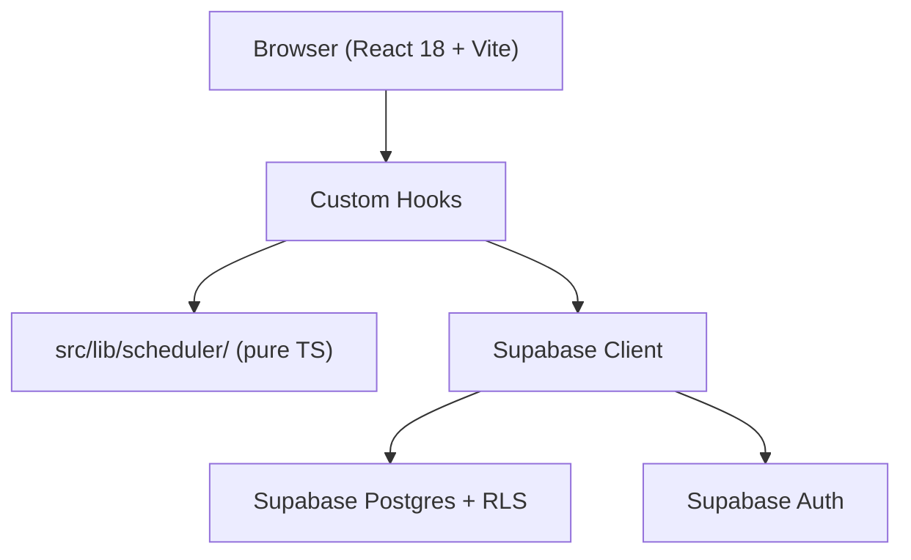

# StudySync

**Adaptive study planner for university students.**

StudySync generates a personalised study schedule from your subjects, exam dates, topics, and free time — then adapts it automatically every time life gets in the way. Every recommendation is explained in plain language.

---

## Screenshots

> _Add screenshots here after first deployment._

---

## Architecture



See [`docs/ARCHITECTURE.md`](docs/ARCHITECTURE.md) for detailed sequence diagrams and a full explanation of how the scheduler works.

---

## Setup

### Prerequisites
- Node.js 18+ and npm
- A [Supabase](https://supabase.com) project (free tier works)

### 1. Clone and install

```bash
git clone <your-repo-url>
cd studysync
npm install
```

### 2. Configure environment variables

```bash
cp .env.example .env
```

Edit `.env` and fill in:
```
VITE_SUPABASE_URL=https://your-project.supabase.co
VITE_SUPABASE_ANON_KEY=your-anon-key
```

**Never** put the service role key in `.env` or in the client.

### 3. Run Supabase migrations

In the [Supabase dashboard](https://supabase.com/dashboard) → SQL Editor, run the migrations in order:

1. `supabase/migrations/001_init.sql`
2. `supabase/migrations/002_rls.sql`
3. `supabase/migrations/003_indexes.sql`
4. `supabase/migrations/004_evaluation_view.sql`

Alternatively, use the [Supabase CLI](https://supabase.com/docs/guides/cli):
```bash
supabase db push
```

### 4. Start the development server

```bash
npm run dev
```

Open `http://localhost:5173`.

---

## Running Tests

```bash
npm run test
```

All 33 scheduler unit tests should pass. Tests live in `src/lib/scheduler/__tests__/`.

---

## Building for Production

```bash
npm run build
```

Output is in `dist/`. Zero TypeScript errors is a hard requirement.

---

## Deploying

### Vercel (recommended)

1. Push to GitHub.
2. Import the repo in [Vercel](https://vercel.com).
3. Set environment variables: `VITE_SUPABASE_URL` and `VITE_SUPABASE_ANON_KEY`.
4. Vercel auto-detects Vite and uses `vercel.json` for security headers and routing.

### Netlify

1. Push to GitHub.
2. Import in [Netlify](https://app.netlify.com).
3. Build command: `npm run build`, publish directory: `dist`.
4. Add the same env vars in Netlify → Site settings → Environment.

---

## How the Scheduler Works

The scheduler is a pure TypeScript module in `src/lib/scheduler/`. It runs in the browser — no network calls, fully deterministic.

**Priority score per topic per day:**
```
priority = 0.40 × urgency + 0.20 × difficulty + 0.25 × weakness + 0.15 × remaining
```

- `urgency = 1 / (1 + daysLeft / 7)` — 1.0 on the exam day, ~0.5 at 7 days
- `difficulty` — normalised from the student's 1–5 difficulty rating
- `weakness` — composite of confidence deficit, missed sessions, and low understanding
- `remaining` — fraction of the topic not yet covered

The greedy planner fills each day's capacity with the highest-priority available topic, respecting the interleaving limit and the final-day revision rule. When a task is missed, the topic's weakness score rises automatically, moving it up in future rankings.

See [`docs/ARCHITECTURE.md`](docs/ARCHITECTURE.md) for a complete explanation.

---

## Limitations

- No push notifications (future scope)
- No calendar integrations (Google Calendar, LMS)
- No predictive ML models — the scheduler is rule-based and transparent by design
- SUS evaluation is based on a small sample (8–10 students) — results are preliminary
- Spaced revision uses fixed offsets; an adaptive algorithm (SM-2) is a future improvement

## Future Scope

- Google Calendar sync
- AI tutor chat (separate from scheduling)
- Native mobile app (React Native)
- Predictive ML for difficulty/confidence estimation
- Push notifications for daily reminders
- Social study groups

---

## Project Info

Built for a B.Tech Cyber Security (Semester I) university project.
