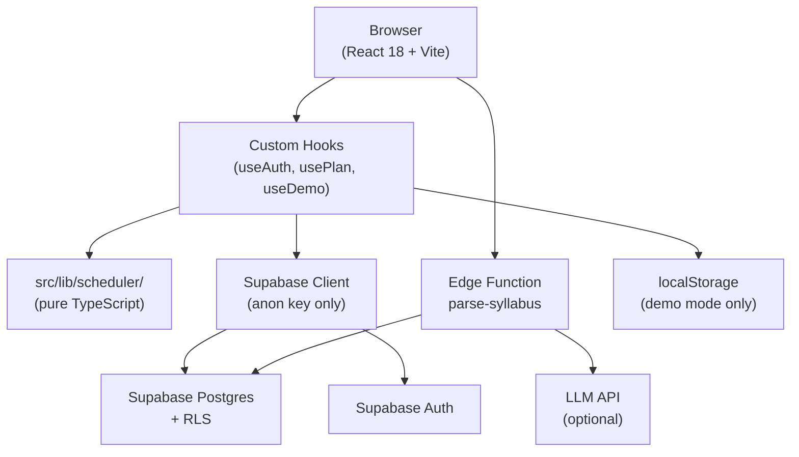
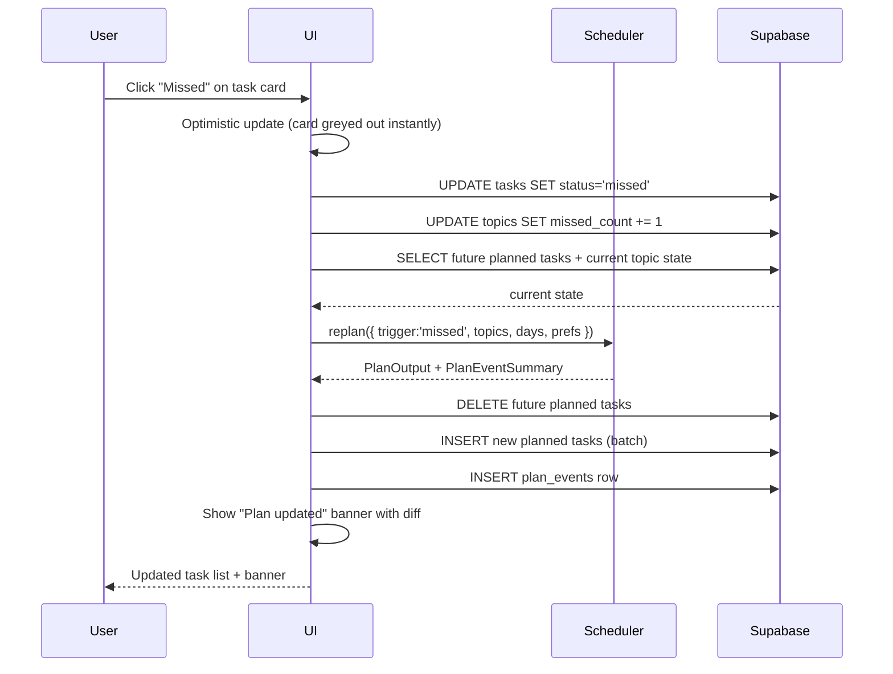

# StudySync — Architecture

## System Overview

The scheduler runs entirely **in the browser** as a pure TypeScript module with no network calls. Supabase is the only backend. The Edge Function is optional and the app works fully without it.

---

## Sequence: Mark Missed → Re-plan

---

## How the Scheduler Works

StudySync's scheduler is a pure TypeScript module in `src/lib/scheduler/`. It is deterministic: the same input always produces the same output. It has no network calls, no randomness, and no external dependencies beyond `date-fns`.

### Priority Scoring

Every topic receives a priority score between 0 and 1 for each planning day. The score combines four factors:

| Factor | Weight | What it measures |
|---|---|---|
| Urgency | 40% | How close the exam is — rises exponentially as the exam approaches |
| Difficulty | 20% | How hard the student rated the topic (1–5) |
| Weakness | 25% | Composite of low confidence, missed sessions, and low post-session understanding |
| Remaining | 15% | How much of the topic hasn't been covered yet |

The weakness sub-score weights confidence at 50%, missed count at 30%, and understanding at 20%.

All weights are defined in `src/lib/scheduler/config.ts` and documented with comments explaining the effect of increasing or decreasing each weight.

### Planning Algorithm

1. Build a list of days from today to the latest exam date (capped at 60 days).
2. For each day, determine capacity (from weekly availability or a date override).
3. Greedy fill: score all topics for that day, pick the highest-priority one with remaining work, schedule a block of `min(blockMinutes, remainingNeed)`, deduct from capacity. Repeat until capacity is used.
4. Interleaving rule: never schedule the same subject more than `maxConsecutiveSameSubject` blocks in a row when another subject has remaining work.
5. Final-day rule: the day before an exam is revision-only for that subject — no new topics.
6. After filling all days, detect overload: if total required minutes exceed available minutes before an exam, return a shortfall warning.

### Adaptation

When a task is marked Missed:
- `missed_count` increments on the topic → its weakness score rises → it appears higher in future priority rankings.
- All future planned tasks are dropped and regenerated by the replanner.
- A `plan_events` row records what changed and why.

When a task is marked Done with an understanding rating:
- `coverage` increases and `confidence` is updated via exponential moving average.
- If understanding ≤ 2, a re-plan is triggered immediately.
- Spaced revision tasks are created at +1, +3, +7, +14 days.

### Explainability

Every task stores a `reasons: string[]` array and a `priorityScore`. The UI displays these in a "Why this?" popover on each task card, alongside a stacked bar showing each factor's percentage contribution to the score. No LLM is involved in scheduling decisions.

---

## Security Model Summary

- **RLS on every table**: users can only read, write, and delete their own rows. Cross-user queries return 0 rows.
- **Anon key only in the browser**: the Supabase service role key never leaves the Edge Function environment.
- **No `dangerouslySetInnerHTML`**: React escapes all rendered content.
- **CSP headers** via `vercel.json` restrict scripts to `'self'` and connections to Supabase only.
- **Input validation** on both the client (zod) and the database (check constraints).
- See `SECURITY.md` for the full threat model.
